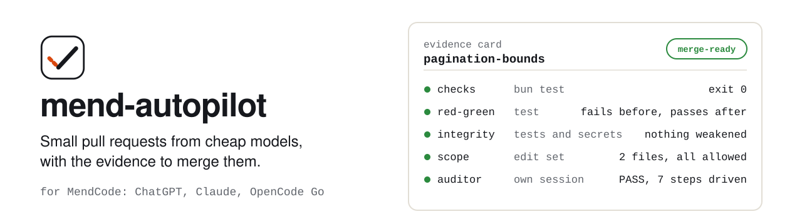
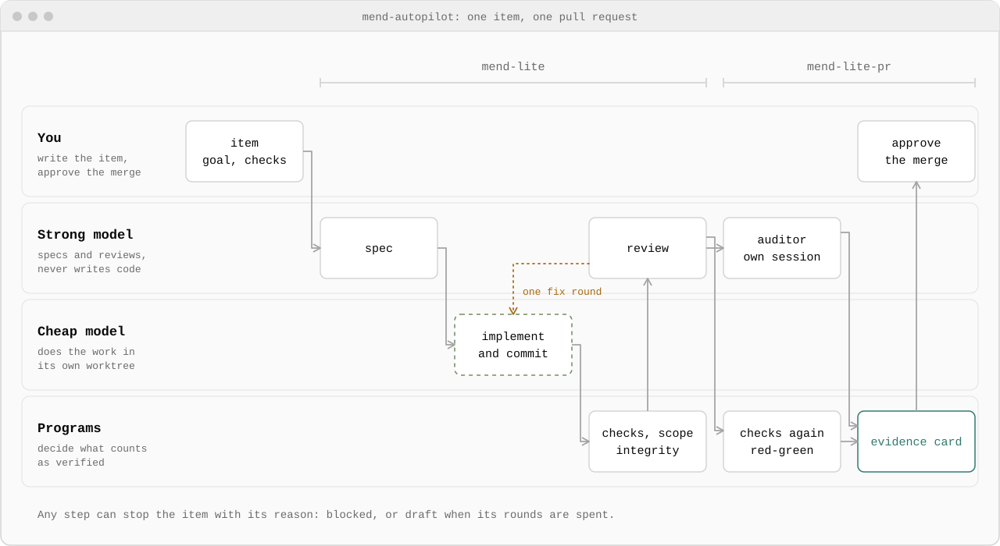

<picture>
  <source media="(prefers-color-scheme: dark)" srcset="docs/assets/banner-dark.svg">
  
</picture>

Cheap models write plausible code fast. The hard part is knowing which of their pull requests you can merge. mend-autopilot is a set of [MendCode](https://github.com/MendCode/MendCode) packages that splits the work so you don't have to take a model's word for it:

- a **strong model** writes the spec and reviews the result, and never implements;
- a **cheap model** does the work, one small item at a time, in its own git worktree;
- **programs**, not models, decide what counts as verified: the checks, the scope, a regression test that must fail before the change and pass after it, and a scan for weakened tests and secrets.

Every pull request comes with an evidence card that records all of it. You read the card and decide whether to merge. Nothing is pushed or merged for you.

## How it works

<picture>
  <source media="(prefers-color-scheme: dark)" srcset="docs/assets/pipeline-dark.svg">
  
</picture>

1. **You write an item.** One observable outcome, the files the model may touch, the commands that prove it works and, for a bug, a regression test.
2. **`mend-lite` builds and reviews it.** The strong model turns the item into a spec, the cheap model implements and commits, and the workflow runs the checks, the scope check and the integrity scan itself. The strong model then reviews; a blocking finding sends the work back for one fix round.
3. **`mend-lite-pr` proves it.** On a clean checkout of the reviewed commit it runs the checks again and the red-green test, and an auditor in a separate session drives the change the way a user would. The result is the evidence card.
4. **You decide.** The best state an item can reach is `merge-ready`. If anything fails, the item stops with the reason (`blocked`, or `draft` when its rounds are spent) instead of guessing.

UI work, refactors and migrations use the full path, `mend-quality` and `mend-pr`: work profiles with executable rubrics, critique rounds against reference examples and human approval where a profile requires it.

## What you get with each pull request

An excerpt of a real card, for a bug fix in a copy of the Next.js tutorial dashboard:

```json
{
  "item": "pagination-bounds",
  "state": "merge-ready",
  "risk": { "tier": "medium", "rule": "shared module path: app/lib/utils.ts" },
  "owner": { "model": "gpt-6.1-terra" },
  "checks": [{ "command": "sh .mendcode/skills/verify-acme-dashboard/scripts/check.sh", "exit": 0 }],
  "redGreen": { "command": "bun test tests/pagination.test.ts", "baseExit": 1, "headExit": 0 },
  "integrity": { "pass": true, "flags": [] },
  "review": { "critic": "gpt-6-astra", "verdict": "merge" },
  "verdict": { "result": "PASS", "verifierModel": "gpt-6-astra" },
  "notVerified": ["Browser rendering and invoice-query clamping were not exercised"],
  "rollback": "revert the merge commit"
}
```

`notVerified` matters as much as the passes: the card says what nobody checked. The full format is in [`evidence-card.md`](core/skills/mend-ship/evidence-card.md), with a JSON schema that every card is validated against.

## Packages

One package per subscription. Each installs and works on its own.

| Package | Subscription | Cheap model | Strong model | State |
|---|---|---|---|---|
| `mend-autopilot-codex` | ChatGPT | gpt-6-luna or gpt-6.1-terra | gpt-6-astra | Used end to end |
| `mend-autopilot-claude` | Claude Pro or Max | claude-haiku or claude-sonnet | claude-opus | Configured, not yet run live |
| `mend-autopilot-opencode-go` | OpenCode Go | deepseek-v4.1-flash | gemini-4-carbon or gemini-4-argon | Configured, not yet run live |

Each package ships recipes that set MendCode's model roles for your plan; applying one is always your step. The adapters' `MAPPING.md` files ([Codex](adapters/codex/MAPPING.md), [Claude](adapters/claude/MAPPING.md), [OpenCode Go](adapters/opencode-go/MAPPING.md)) list the recipes, the workflow arguments and what has not been verified on that harness.

## Quick start

You need MendCode, Node 20+, Python 3.9+ and git.

```sh
git clone https://github.com/MendCode/mend-autopilot && cd mend-autopilot
node build.mjs codex
mendcode package install "$PWD/dist/mend-autopilot-codex"
```

Open a MendCode session on a ChatGPT model and run `/mend-setup`. It changes nothing: it checks the engine, the tools, the install and that the guard blocks a probe, then prints the recipe for your plan and the safety steps for you to apply.

In the repository you want to work on, ignore `.mend/` in git and add a verification skill (the `create-verification` skill writes one). Then describe an item in `.mend/items/<id>.json`:

```json
{
  "id": "pagination-bounds",
  "type": "change",
  "goal": "generatePagination returns a valid page list for any current page and page count",
  "acceptance": ["a non-finite current page is treated as page 1", "results for valid inputs are unchanged"],
  "profiles": ["bugfix"],
  "editSet": ["app/lib/utils.ts", "tests/pagination.test.ts"],
  "checks": ["bun test"],
  "regression": "bun test tests/pagination.test.ts",
  "risk": "low"
}
```

and run the two workflows:

```text
/workflows run mend-lite repo=/abs/path/to/project item=.mend/items/pagination-bounds.json pkg=<package dir> critic=gpt-6-astra model=gpt-6.1-terra
/workflows run mend-lite-pr repo=/abs/path/to/project item=.mend/items/pagination-bounds.json pkg=<package dir> auditor=gpt-6-astra
```

`<package dir>` is the `dir` that `mendcode package list --json` prints. The full item format is in [`mend-mode`](core/skills/mend-mode/SKILL.md) §5.

<details>
<summary><b>Claude</b></summary>

Sessions on Claude models run on the Claude Code engine, which loads Claude Code's skills and hooks, not MendCode's. The Claude package is also a Claude Code plugin that brings the skills, `/mend-setup` and the guard:

```sh
node build.mjs claude
mendcode package install "$PWD/dist/mend-autopilot-claude"
claude plugin marketplace add "$PWD/dist/mend-autopilot-claude"
claude plugin install mend-autopilot@mend-autopilot-local
```

The plugin's guard acts only inside repositories that have a `.mend/` folder, so the rest of your Claude Code work is not affected. Pass `engine=claude` and Claude model ids to the workflows; see the [Claude mapping](adapters/claude/MAPPING.md).

</details>

<details>
<summary><b>OpenCode Go</b></summary>

Install `mend-autopilot-opencode-go` and log in to MendCode's native `opencode-go` provider (and `opencode`, OpenCode Zen, for Gemini Carbon). `/mend-setup` prints the exact lines and checks that your account can reach each model. The OpenCode ACP agent cannot be used: MendCode workflows refuse ACP agents and the guard does not run there. See the [OpenCode Go mapping](adapters/opencode-go/MAPPING.md).

</details>

## Safety

A pre-tool guard runs before every tool call and blocks the destructive or out-of-scope ones: database drops, `rm -r` outside the worktree, force pushes, reading secret files, dependency additions nobody granted, and commands that reach a host you marked as production. It is a seatbelt, not a sandbox. Installing a package never changes models, permissions, trust or tiers; those stay yours. See [safety setup](core/docs/safety-setup.md).

## Status

v0.1. The Codex package has been used end to end on test repositories. The Claude and OpenCode Go packages pass every offline check (package validation, plugin validation, guard events and the full test suite) but have not yet run with their models. Expect rough edges and report them.

## Documentation

- [Development](docs/development.md): layout, build, tests and what the workflows need from the host
- [Harness matrix](docs/harness-matrix.md): what was measured on each harness and what was not
- [Safety setup](core/docs/safety-setup.md): the guard's rules and the deny rules to set yourself
- [Evidence card](core/skills/mend-ship/evidence-card.md): every field of the card

## Acknowledgements

[pstack](https://github.com/cursor/plugins/tree/main/pstack) by Lauren Tan (MIT) saved us part of the groundwork. Two of its ideas shaped this project: treating a project's verification skill as infrastructure, and keeping one harness-neutral core with a mapping per harness. mend-autopilot has its own design: cheap-model owners with round budgets, work profiles with executable rubrics, the integrity check, the evidence card and the per-subscription packages. All of its text and code were written from scratch.

[tstack](https://github.com/t3dotgg/tstack) by Theo Browne (MIT) sharpened the quality loop. From it we took the idea that a critic should score the current work against the previous version and reference examples in one pass, that the owner should never hear the passing score, and that an optimisation loop keeps a change only when a metric improves while a guard holds. Our versions add what the loop needs to be checked by a program: anchor scores that void a round when they drift, a findings ledger that only a later critic reply can close, and a climb check that runs both commits in isolation and refuses edits to frozen files. None of its text or code was copied.

## License

[MIT](LICENSE)
