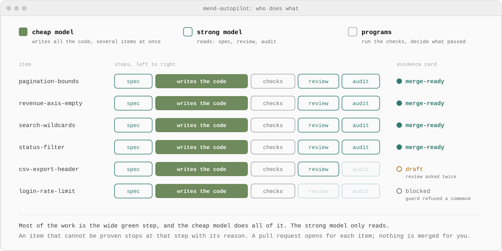
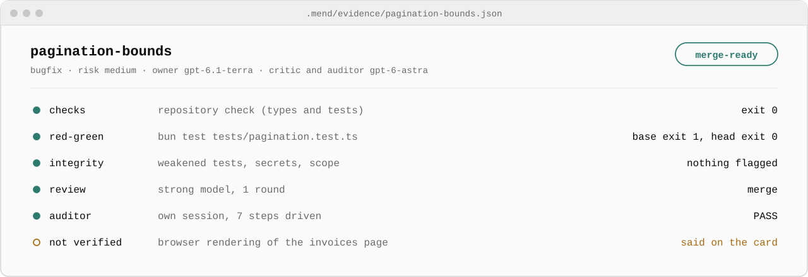

<p align="center">
  <picture>
    <source media="(prefers-color-scheme: dark)" srcset="docs/assets/logo-dark.svg">
    
  </picture>
</p>

<h1 align="center">mend-autopilot</h1>

<p align="center"><sub>Cheap models write. A strong model checks. Programs decide.</sub></p>

<h3 align="center">1,500+ pull requests a month from cheap models, at the quality of an expensive one.</h3>

<p align="center">About 50 a day. The cheap model writes every line of code; the expensive model only writes the spec, reviews the result and audits it; programs, not models, decide what passed. Every pull request arrives with the evidence to merge it.</p>

<p align="center">
  <a href="https://github.com/MendCode/MendCode"></a>
  <a href="#status"></a>
  <a href="LICENSE"></a>
</p>

<p align="center">
  <a href="#how-it-works">How it works</a> ·
  <a href="#does-it-work">Does it work?</a> ·
  <a href="#install-with-your-ai-assistant">Install with AI</a> ·
  <a href="#quick-start">Quick start</a> ·
  <a href="#packages">Packages</a> ·
  <a href="#the-evidence-card">Evidence card</a> ·
  <a href="docs/development.md">Development</a>
</p>

<p align="center">
  <picture>
    <source media="(prefers-color-scheme: dark)" srcset="docs/assets/overview-dark.svg">
    
  </picture>
</p>

## Why

A cheap model can write a plausible pull request in minutes. Fifty of them a day is easy to produce and impossible to review by hand, and "the model says the tests pass" is not evidence. Running the expensive model on everything fixes the quality and burns the subscription by lunch.

mend-autopilot spends each model where it is worth the most:

- **The cheap model does the volume.** One small item at a time, in its own git worktree, a few owners in parallel.
- **The expensive model does the judgment.** It turns each item into a spec, reviews the result, and audits it in a separate session. It never writes the code.
- **Programs do the verifying.** The checks, the scope, a regression test that must fail before the change and pass after it, and a scan for weakened tests and secrets all run as code, not as a model's opinion.
- **You just ask, and you merge.** Ask for a fix or a feature in plain words. Each one comes back as an open pull request with an evidence card that says what passed and what nobody checked. Nothing is merged for you.

## How it works

<picture>
  <source media="(prefers-color-scheme: dark)" srcset="docs/assets/pipeline-dark.svg">
  
</picture>

1. **You ask; the lead writes the items.** The session you talk to turns your request into small items: one observable outcome each, the files the model may touch, the commands that prove it and, for a bug, a regression test. The first time, it also finds your repository's check commands and records that they pass.
2. **`mend-lite` builds and reviews it.** The strong model writes the spec, the cheap model implements and commits, and the workflow runs the checks, the scope check and the integrity scan itself. The strong model then reviews; a blocking finding sends the work back for one fix round.
3. **`mend-lite-pr` proves it.** On a clean checkout of the reviewed commit it runs the checks again and the red-green test, and an auditor in a separate session drives the change the way a user would. The result is the evidence card.
4. **The pull request opens; you merge.** A `merge-ready` item is pushed to its own `mend/<id>` branch and opens a pull request with the card as its description. A `draft` (rounds spent) opens a draft pull request that says why; a `blocked` item is never pushed. Nothing is merged for you, and nothing is force-pushed.

UI work, refactors and migrations take the full path, `mend-quality` and `mend-pr`: work profiles with executable rubrics, critique rounds against reference examples, and human approval where a profile requires it.

## Does it work?

Pilot results on a ChatGPT plan, with gpt-6.1-terra as the cheap model and gpt-6-astra as the strong one. The samples are small; read them as a first signal, not a benchmark.

| What was compared | Result |
|---|---|
| Code changes: cheap owner with strong review vs strong model alone | Accepted on **9 of 10** items vs 6 of 9. The cheap owner used **a third to half** of the strong model's input tokens. |
| Six tasks with hidden tests | Strong alone, cheap alone and cheap with mend-autopilot each passed 5 of 6; the cheap model with the kit used **about a third** of the strong model's output tokens. |
| Light path on two test repositories | **8 of 8** results accepted by a person, each with its regression test failing before and passing after. |
| UI screens, blind votes | From scratch, the strong model alone still won. With the strong model's written direction, the cheap model's screens scored the same as the strong model's in the latest round. |

The 1,500-a-month figure is what the design is built for: several cheap owners at once, the strong model only at three short steps per item, and programs for everything that can be checked. It has not yet been measured at that volume.

## The evidence card

<picture>
  <source media="(prefers-color-scheme: dark)" srcset="docs/assets/card-dark.svg">
  
</picture>

A real card from the pilot, shortened. The JSON behind it records the commands and their exit codes, both commits of the red-green run, the reviewer's findings by round, the auditor's method per lane, the risk rule that applied and how to roll back. `notVerified` matters as much as the passes: the card says what nobody checked. Every card is validated against a [JSON schema](core/skills/mend-ship/evidence-card.schema.json); the fields are described in [`evidence-card.md`](core/skills/mend-ship/evidence-card.md).

## Quick start

### Install with your AI assistant

Paste this into MendCode, Claude Code, Codex or any coding agent:

```text
Fetch https://raw.githubusercontent.com/MendCode/mend-autopilot/main/install.md and follow it.
```

It checks the requirements, picks the package for your subscription, builds and installs it, and prepares your project, asking before each step that changes something. It never touches your models, permissions or tier.

### Use it

Open a MendCode session in your repository and ask for what you want:

```text
Sign-in fails when the email has capital letters. Fix it.
```

That is all. The `mend-autopilot` skill loads by itself whenever you ask for a change in a repository that already uses it, or ask for a pull request anywhere. It prepares the repository the first time (without changing a tracked file), splits the request into items, and starts one `mend` run per item. MendCode lets only you start a workflow, so each run starts once you approve its card; that is the only click. You follow the runs in `/workflows` and get one pull request per item, from your fork when you cannot push to the repository. It asks before going ahead only for high-risk items: sign-in, permissions, payments, migrations, deletions or a public API.

### Install by hand

You need [MendCode](https://github.com/MendCode/MendCode), Node 20+, Python 3.9+ and git.

```sh
git clone https://github.com/MendCode/mend-autopilot && cd mend-autopilot
node build.mjs codex
mendcode package install "$PWD/dist/mend-autopilot-codex"
```

Open a MendCode session on a ChatGPT model and run `/mend-setup`. It changes nothing: it checks the engine, the tools, the install and that the guard blocks a probe, then prints the recipe for your plan and the safety steps for you to apply.

<details>
<summary><b>Writing items and running workflows by hand</b></summary>

In the repository you want to work on, run `node <package dir>/checks/setup-light.mjs --repo "$PWD" --command "<your check command>"` (or write a full verification skill with `create-verification`). Then describe an item in `.mend/items/<id>.json`:

```json
{
  "id": "pagination-bounds",
  "type": "change",
  "goal": "generatePagination returns a valid page list for any current page and page count",
  "acceptance": ["a non-finite current page is treated as page 1", "results for valid inputs are unchanged"],
  "profiles": ["bugfix"],
  "editSet": ["app/lib/utils.ts", "tests/pagination-bounds.test.ts"],
  "checks": ["bun test"],
  "regression": "bun test tests/pagination-bounds.test.ts",
  "risk": "low"
}
```

New tests go in a new file: the integrity scan blocks any change to an existing test file. Run it all, through the pull request:

```text
/workflows run mend repo=/abs/path/to/project item=.mend/items/pagination-bounds.json pkg=<package dir> critic=gpt-6-astra model=gpt-6.1-terra auditor=gpt-6-astra
```

`mend` is `mend-lite`, then `mend-lite-pr`, then the pull request; the two halves also run on their own, and `publish=no` keeps the branch local. `<package dir>` is the `dir` that `mendcode package list --json` prints. The full item format is in [`mend-mode`](core/skills/mend-mode/SKILL.md) §5.

</details>

<details>
<summary><b>On a Claude subscription</b></summary>

Sessions on Claude models run on the Claude Code engine, which loads Claude Code's skills and hooks, not MendCode's. The Claude package is also a Claude Code plugin that brings the skills, `/mend-setup` and the guard:

```sh
node build.mjs claude
mendcode package install "$PWD/dist/mend-autopilot-claude"
claude plugin marketplace add "$PWD/dist/mend-autopilot-claude"
claude plugin install mend-autopilot@mend-autopilot-local
```

The plugin's guard acts only inside repositories that have a `.mend/` folder, so the rest of your Claude Code work is not affected. Pass `engine=claude` and Claude model ids to the workflows; see the [Claude mapping](adapters/claude/MAPPING.md).

</details>

<details>
<summary><b>On OpenCode Go</b></summary>

Install `mend-autopilot-opencode-go` and log in to MendCode's native `opencode-go` provider (and `opencode`, OpenCode Zen, for Gemini Carbon). `/mend-setup` prints the exact lines and checks that your account can reach each model. The OpenCode ACP agent cannot be used: MendCode workflows refuse ACP agents and the guard does not run there. See the [OpenCode Go mapping](adapters/opencode-go/MAPPING.md).

</details>

## Packages

One package per subscription. Each installs and works on its own.

| Package | Subscription | Cheap model | Strong model | State |
|---|---|---|---|---|
| `mend-autopilot-codex` | ChatGPT | gpt-6-luna or gpt-6.1-terra | gpt-6-astra | Used end to end |
| `mend-autopilot-claude` | Claude Pro or Max | claude-haiku or claude-sonnet | claude-opus | Configured, not yet run live |
| `mend-autopilot-opencode-go` | OpenCode Go | deepseek-v4.1-flash | gemini-4-carbon or gemini-4-argon | Configured, not yet run live |

Each package ships recipes that set MendCode's model roles for your plan; applying one is always your step. The adapters' `MAPPING.md` files ([Codex](adapters/codex/MAPPING.md), [Claude](adapters/claude/MAPPING.md), [OpenCode Go](adapters/opencode-go/MAPPING.md)) list the recipes, the workflow arguments and what has not been verified on that harness.

## Your own instructions

mend-autopilot adds skills, commands, workflows and a guard. It sets no prompt, look, model or tier, so it runs next to the profiles and instructions you already use instead of replacing them.

- **They reach every agent.** The owner, critic and auditor of a workflow are ordinary MendCode sessions, so each one gets what your sessions get: the project's `AGENTS.md`, the `APPEND_SYSTEM.md` of your profiles or of `.mendcode/`, your skills and your memory. On a Claude model, Claude Code adds your `CLAUDE.md`.
- **Keep them compatible.** A rule like "never start sub-agents" or "ask before every edit" also binds the owner and can stop an item. Rules about style, naming or tests are what work best.
- **Per project:** the verification skill holds the commands that prove the project works; each item's `editSet`, `checks` and `acceptance` narrow one task; a work profile under `core/profiles/` adds a rubric that a program checks.

## Safety

A pre-tool guard runs before every tool call and blocks the destructive or out-of-scope ones: database drops, `rm -r` outside the worktree, force pushes, reading secret files, dependency additions nobody granted, and commands that reach a host you marked as production. It is a seatbelt, not a sandbox. Installing a package never changes models, permissions, trust or tiers; those stay yours. See [safety setup](core/docs/safety-setup.md).

## Status

v0.1. The Codex package has been used end to end on test repositories. The Claude and OpenCode Go packages pass every offline check (package validation, plugin validation, guard events and the full test suite) but have not yet run with their models. Expect rough edges and report them.

## Documentation

- [Development](docs/development.md): layout, build, tests and what the workflows need from the host
- [Harness matrix](docs/harness-matrix.md): what was measured on each harness and what was not
- [Safety setup](core/docs/safety-setup.md): the guard's rules and the deny rules to set yourself
- [Evidence card](core/skills/mend-ship/evidence-card.md): every field of the card

## Acknowledgements

[pstack](https://github.com/cursor/plugins/tree/main/pstack) by Lauren Tan (MIT) saved us part of the groundwork. Two of its ideas shaped this project: treating a project's verification skill as infrastructure, and keeping one harness-neutral core with a mapping per harness. mend-autopilot has its own design: cheap-model owners with round budgets, work profiles with executable rubrics, the integrity check, the evidence card and the per-subscription packages. All of its text and code were written from scratch.

[tstack](https://github.com/t3dotgg/tstack) by Theo Browne (MIT) sharpened the quality loop. From it we took the idea that a critic should score the current work against the previous version and reference examples in one pass, that the owner should never hear the passing score, and that an optimisation loop keeps a change only when a metric improves while a guard holds. Our versions add what the loop needs to be checked by a program: anchor scores that void a round when they drift, a findings ledger that only a later critic reply can close, and a climb check that runs both commits in isolation and refuses edits to frozen files. None of its text or code was copied.

## License

[Apache-2.0](LICENSE). The MendCode name and logo are not covered by the license; see [NOTICE](NOTICE).
